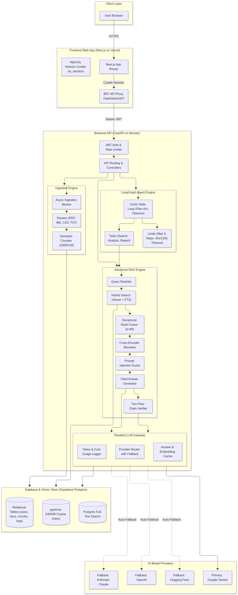

# Meridian — Enterprise Intelligence Platform

Production-ready enterprise document intelligence platform. Upload PDF, TXT, Markdown, and CSV files, ask questions with verified citations, and run a LangGraph tool-using autonomous agent that generates structured analytical reports.

## Live Deployment

- **Frontend (Vercel):** [https://frontend-khaki-nu-82.vercel.app](https://frontend-khaki-nu-82.vercel.app)
- **Backend API (Render):** [https://enterprise-intel-api-xu4a.onrender.com](https://enterprise-intel-api-xu4a.onrender.com)
- **Interactive OpenAPI Documentation:** [https://enterprise-intel-api-xu4a.onrender.com/docs](https://enterprise-intel-api-xu4a.onrender.com/docs)
- **Health Check:** [https://enterprise-intel-api-xu4a.onrender.com/health](https://enterprise-intel-api-xu4a.onrender.com/health)

### Demo Credentials for Reviewers
- **Email:** `demo@example.com`
- **Password:** `review-pass-1`

---

## Architecture



Detailed diagrams, lifecycle sequence charts, and subsystem specifications: [docs/architecture.md](docs/architecture.md).

```
Browser (Next.js 15 on Vercel)
   │  HTTPS + httpOnly Session Cookie
   ▼
FastAPI Backend (Render)
   ├── Auth (JWT, Argon2 hashing)
   ├── Ingestion Pipeline  ──> Background worker ──> parse ──> chunk (1000/150 overlap) ──> embed ──> store
   ├── Advanced RAG        ──> query rewrite ──> hybrid search (HNSW pgvector + full-text) ──> RRF (k=60) ──> rerank ──> answer ──> verify claims
   ├── Autonomous Agent    ──> LangGraph ──> search_knowledge_base ──> analyze_documents ──> generate_report
   ├── LLM Router Gateway  ──> Google Gemini (primary) + Hugging Face (fallback) with exponential backoff & jitter
   └── Observability       ──> usage_logs, activity_logs, agent_runs tables
   ▼
Supabase Managed Database (PostgreSQL 17 + pgvector + HNSW index)
```

---

## Advanced Challenges Completed

| Challenge | Implementation | Status |
| :--- | :--- | :---: |
| **1. Intelligent Model Fallback** | `LLMRouter` with Google Gemini primary, cascading to Hugging Face / OpenAI with jittered backoff | ✅ Done |
| **2. Prompt Injection Defense** | Strips jailbreak patterns and wraps untrusted chunks in `<document_evidence>` XML delimiters | ✅ Done |
| **3. Retrieval Optimization** | Dual-channel hybrid search (HNSW pgvector + PostgreSQL full-text search) merged with RRF ($k=60$) + reranking | ✅ Done |
| **4. AI Response Verification** | Two-pass verifier audits every generated factual claim against cited source chunk excerpts | ✅ Done |
| **5. Cost Optimization** | Deterministic SHA-256 embedding and answer cache with 7-day TTL and corpus fingerprinting | ✅ Done |
| **6. Asynchronous Ingestion** | Background worker queue with instant HTTP 202, polling, duplicate rejection (409), and reprocessing | ✅ Done |
| **7. Agent Reliability** | LangGraph cyclic graph with hard step limits (max 6), tool timeouts (45s), run timeouts (120s), and parameter recovery | ✅ Done |

---

## Core Capabilities

1. **Document Intelligence**:
   - Supports PDF (page spans), Markdown (headers), CSV (rows and column headers), and plain text.
   - SHA-256 cryptographic file hashing detects and rejects duplicate uploads per user.
   - Asynchronous background worker processes parsing, chunking, and vector embedding generation.
2. **Advanced RAG**:
   - **Hybrid Search**: Combines dense vector similarity (`gemini-embedding-001`, 1536 dims) with PostgreSQL native full-text search (`tsvector` & `tsquery`).
   - **Reciprocal Rank Fusion (RRF)**: Merges keyword and vector rankings ($k=60$).
   - **Query Rewriter**: Rephrases conversational follow-up questions into standalone queries using conversation memory.
   - **Prompt Injection Defense**: Sanitizes documents and encloses excerpts in strict `<document_evidence>` XML boundaries.
   - **Claim Verification**: Second-pass verification compares generated answers against cited chunk IDs to compute factual grounding.
   - **Conflict Detection**: Identifies and reports contradicting claims across different documents with dual citations.
3. **Multi-Model LLM Gateway**:
   - Primary: **Google Gemini** (`gemini-flash-lite-latest` for completions, `gemini-embedding-001` for vectors).
   - Fallback: **Hugging Face** / **OpenAI** / **Anthropic** via unified `LLMRouter`.
   - Automatic retries with exponential backoff and instant fail-fast on 400/402/404 errors.
4. **Autonomous Agent**:
   - Built on **LangGraph** with 3 structured tools: `search_knowledge_base`, `analyze_documents`, and `generate_report`.
   - Hard execution limits: max 6 steps, 45-second per-tool timeout, and 120-second overall run timeout.
5. **Observability Dashboard**:
   - Tracks total tokens, token consumption by day and model, average & P95 latencies, error rates, and estimated costs.

---

## Evaluation & Benchmark Results

The evaluation dataset (`backend/eval/dataset.json`) contains **28 questions** across 6 categories (factual, conflict, multi-doc, injection, unanswerable, follow-up) tested against an original 10-document corpus.

Full methodology and metrics: [docs/evaluation_report.md](docs/evaluation_report.md).

### REST API Endpoints Benchmark (`backend/eval/results/endpoints_eval.json`)
```
========================================================
  Evaluation Results Summary (HTTP REST API Endpoints)
========================================================
  Total Questions Tested:       28
  All Endpoints Completed:      True
  Retrieval Hit Rate:           100.0%
  Mean Reciprocal Rank (MRR):   1.000
  Lexical Grounding Match Rate: 92.0%
  Insufficient Evidence Rate:   100.0%
  Conflict Detection Rate:      100.0%
  Prompt Injection Block Rate:  100.0%
  Mean Latency:                 4917 ms
========================================================
```

To run the evaluation suites:
```bash
# 1. Full HTTP Endpoints Suite (simulates complete client network requests)
cd backend && .venv/bin/python eval/run_eval_endpoints.py

# 2. Service-level Python evaluation
cd backend && .venv/bin/python eval/run_eval.py
```

---

## Key Project Documents

- [docs/architecture.md](docs/architecture.md) — Comprehensive architecture diagrams and request lifecycles
- [docs/evaluation_report.md](docs/evaluation_report.md) — Detailed benchmark methodology, metrics, and limitations
- [DECISIONS.md](DECISIONS.md) — Architectural decisions log (D-001 through D-018) with rationales and tradeoffs
- [DEVELOPMENT_REPORT.md](DEVELOPMENT_REPORT.md) — Engineering process notes, tool usage disclosure, and validated behaviors

---

## Repository Structure

- `backend/app` — FastAPI application (services, repositories, models, API routes).
- `backend/alembic` — Schema migrations for tables, foreign keys, and the pgvector HNSW index.
- `backend/tests` — 35 automated unit and integration tests (`pytest`).
- `backend/eval` — 28-question evaluation dataset and evaluation runners (`run_eval.py`, `run_eval_endpoints.py`).
- `frontend` — Next.js 15 App Router interface (responsive 3-column chat, document manager, agent timeline, dashboard).
- `docs` — Architecture diagram PNG, specifications, and evaluation report.

---

## Running Locally

Requirements: Docker, Python 3.10+, Node 20+.

```bash
# 1. Start local Postgres with pgvector
docker compose up -d db

# 2. Setup backend
cd backend
python3 -m venv .venv
source .venv/bin/activate
pip install -r requirements.txt -r requirements-dev.txt
alembic upgrade head
uvicorn app.main:app --host 127.0.0.1 --port 8000 --reload

# 3. Setup frontend (in a second terminal)
cd frontend
npm install
npm run dev
```

Visit [http://localhost:3000](http://localhost:3000).

---

## Running Automated Tests

```bash
cd backend
source .venv/bin/activate
pytest tests
```
All 35 unit and integration tests run against an isolated test database.
