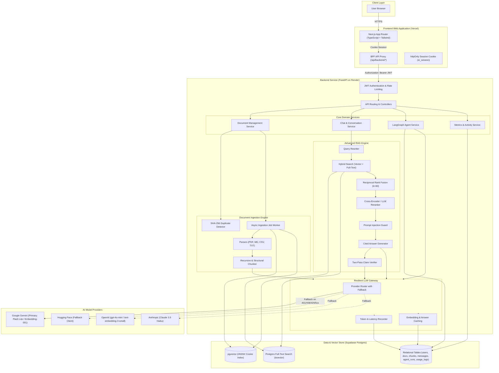
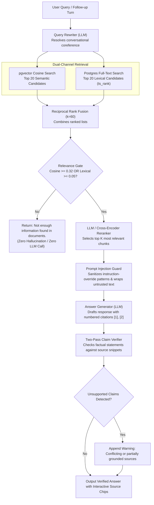

# Meridian: Architecture

## 1. High-Level System Architecture



## 2. Advanced Hybrid RAG & Verification Pipeline



## 3. LangGraph Autonomous Agent State Loop

```mermaid
stateDiagram-v2
    [*] --> Plan

    state Plan {
        description: Evaluates user goal and history to choose tool or finish
    }

    Plan --> ValidateTool: Tool selected

    state ValidateTool {
        description: Validates tool name and Pydantic arguments
    }

    ValidateTool --> Act: Validation Passed
    ValidateTool --> Plan: Validation Error (Feedback to LLM)

    state Act {
        state ToolFork <<choice>>
        ToolFork --> SearchKB: search_knowledge_base
        ToolFork --> AnalyzeDoc: analyze_documents
        ToolFork --> GenReport: generate_report
    }

    SearchKB --> Observe: Query RAG hybrid index
    AnalyzeDoc --> Observe: Extract themes / failure modes across docs
    GenReport --> Observe: Synthesize structured Markdown report

    state Observe {
        description: Persist step to agent_steps table (inputs, output, latency)
    }

    Observe --> CheckLimits: Evaluate Step & Time Limits

    state CheckLimits <<choice>>
    CheckLimits --> Plan: Steps < 6 AND Time < 120s
    CheckLimits --> Finish: Max steps reached OR Timeout

    Plan --> Finish: Agent emits finish tool
    Finish --> [*]: Return structured final report with evidence
```

## 4. End-to-End Request Lifecycles

1. **Upload & Ingestion**:
   - `POST /api/documents/upload` calculates SHA-256 hash. If duplicate, returns `HTTP 409`.
   - Inserts document row (`pending`), responds `HTTP 202 Accepted`, and enqueues background worker.
   - Worker invokes parsers (PDF, TXT, MD, CSV) $\to$ semantic chunker $\to$ batch embedding generation $\to$ stores chunks in `chunks` table with pgvector cosine embeddings $\to$ status transitions to `ready`.
2. **Chat & Hybrid RAG**:
   - Query rewriter resolves contextual follow-ups.
   - Parallel query against `pgvector` (cosine distance) and Postgres FTS (`tsvector`), combined using Reciprocal Rank Fusion ($k=60$).
   - Relevance gate blocks ungrounded queries early; reranker refines chunk ordering.
   - Prompt injection guard filters prompt override attempts and wraps untrusted chunks in XML tags.
   - Answer generator cites source chunks; two-pass verifier audits claims against cited snippets.
3. **Autonomous Agent**:
   - LangGraph cyclical graph: Plan $\to$ Tool Validation $\to$ Act (`search_knowledge_base`, `analyze_documents`, `generate_report`) $\to$ Observe $\to$ Step & Timeout Guards (max 6 steps, 45s/tool, 120s total).
   - Generates structured analytical Markdown report with direct empirical citations.
4. **Security & Session**:
   - Browser never handles API JWTs directly; Next.js BFF sets `ei_session` as an httpOnly, Secure cookie and forwards `Bearer` tokens to FastAPI.
   - Multi-tenant data segregation: all SQL queries enforce explicit `user_id` ownership filtering.

