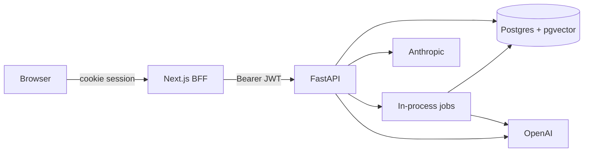

# Architecture

A request is authenticated, then handled by a service:

1. Upload stores the bytes under `user_id/document_id`, records a pending row, and queues ingestion.
2. Ingestion parses, chunks, embeds, and marks the document `ready` or `failed`.
3. Chat rewrites a follow-up, runs hybrid search, drops instruction-like lines, and either returns the insufficient-evidence sentence or asks the router for a cited answer. A verifier checks the draft against the retrieved text.
4. The agent plans a tool, runs it, stores the step, and repeats until it finishes or hits a limit. The report is stored on the run.
5. Usage rows are committed on their own session so a failed request still leaves a log line.

The UI never holds the API token in JavaScript. Next.js route handlers set and forward `ei_session`.
